# NeuralKey — Simulator vs Design

- Commit: `ef7c2ff`
- Simulator: iPhone 17 Pro Max (iOS 26.2)
- Workflow run: https://github.com/farrukh-hussain-shah/Neural-IOS/actions/runs/44115083441
- Keyboard tour video: [video/keyboard-tour.mp4](video/keyboard-tour.mp4)
- Mismatch = share of pixels whose colour differs by more than 32/255, excluding the status bar (47 pt) and home indicator (34 pt).
- Home, Settings and AI Tones follow the Android screenshots (Home ad removed), scaled to 390 pt and aligned to the iOS status bar.
- `Language.svg` and `Premium.svg` are 375 × 812 pt frames, so their references are scaled uniformly to 390 pt.

| Screen | Design file | Mismatch | Note |
| --- | --- | --- | --- |
| Splash | `768w light-3.svg` | 1.62% | simulator 1320x2868 resized to 1170x2532 |
| Language Selection | `Language.svg` | 5.07% | simulator 1320x2868 resized to 1170x2532 |
| Onboarding 1 – Welcome | `390w light.svg` | 4.26% | simulator 1320x2868 resized to 1170x2532 |
| Onboarding 2 – Setup 1 of 3 | `768w light-1.svg` | 3.96% | simulator 1320x2868 resized to 1170x2532 |
| Onboarding 3 – Setup 2 of 3 | `768w light-2.svg` | 4.25% | simulator 1320x2868 resized to 1170x2532 |
| Home | `Home-Android.png` | 6.11% | simulator 1320x2868 resized to 1170x2532 |
| Premium | `Premium.svg` | 5.48% | simulator 1320x2868 resized to 1170x2532 |
| Settings | `Settings-Android.png` | 10.20% | simulator 1320x2868 resized to 1170x2532 |
| AI Tones | `AITones-Android.png` | 14.61% | simulator 1320x2868 resized to 1170x2532 |
| NeuralKey keyboard – Letters (light) | `Keyboard Designs/Defaulta.svg` | 3.68% | pixels outside the design's rounded corners are not scored |
| NeuralKey keyboard – Numbers (light) | `Keyboard Designs/Defaultb.svg` | 2.98% | pixels outside the design's rounded corners are not scored |

## Splash

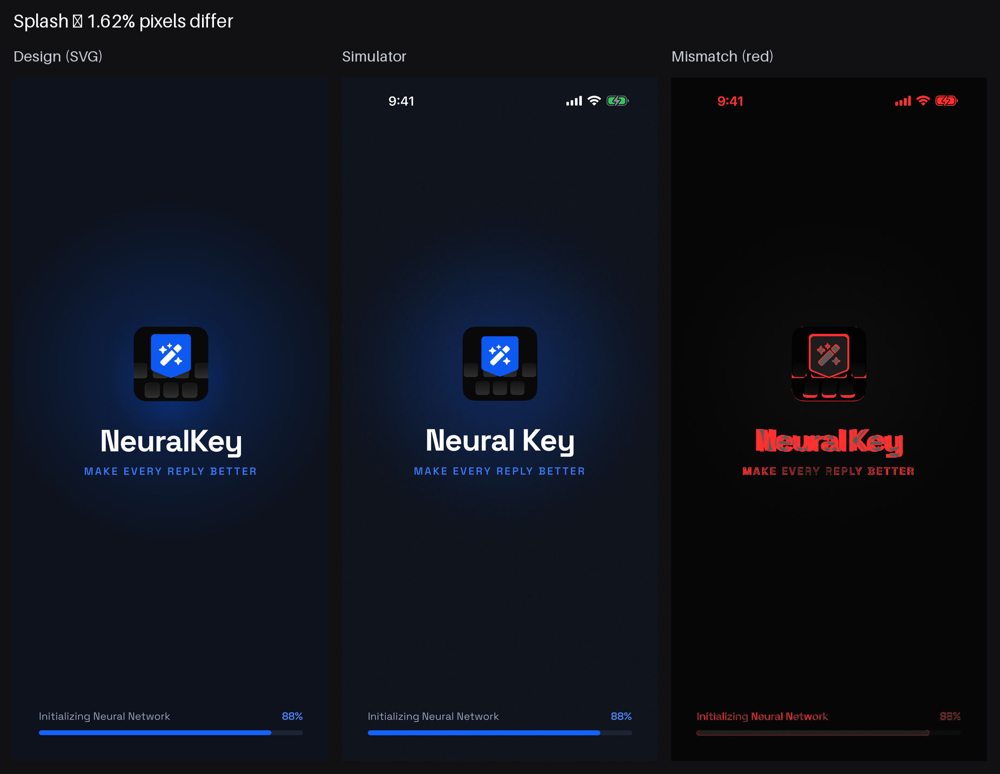

Full size: [design](design/01-splash.png) · [simulator](screenshots/01-splash.png)

## Language Selection

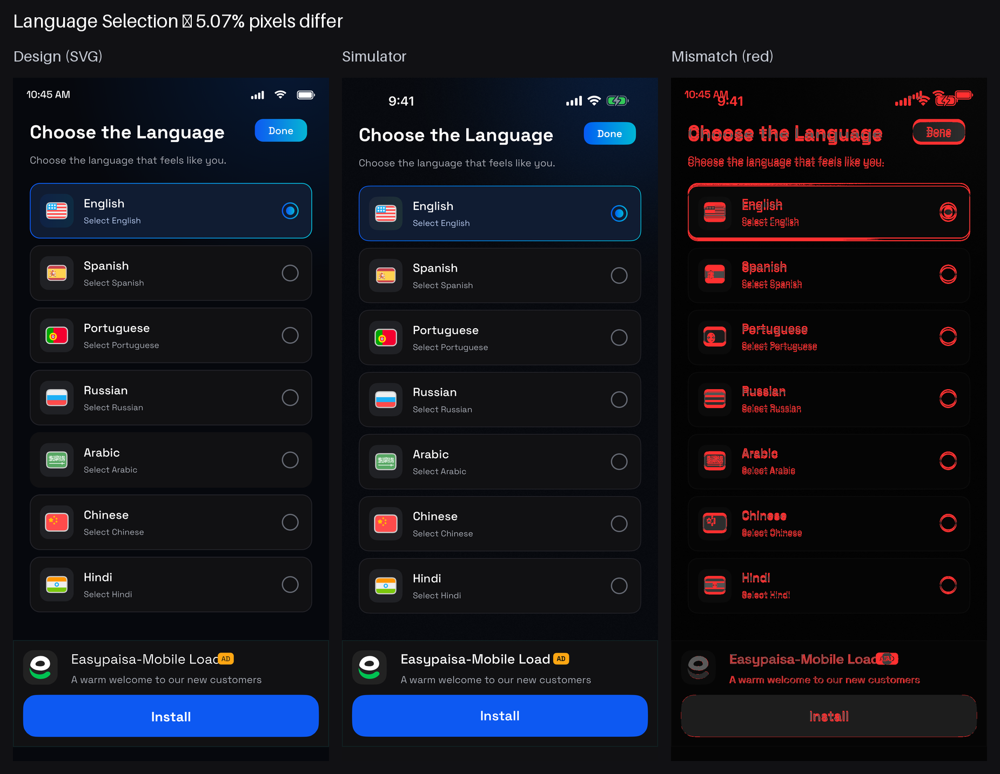

Full size: [design](design/02-language.png) · [simulator](screenshots/02-language.png)

## Onboarding 1 – Welcome

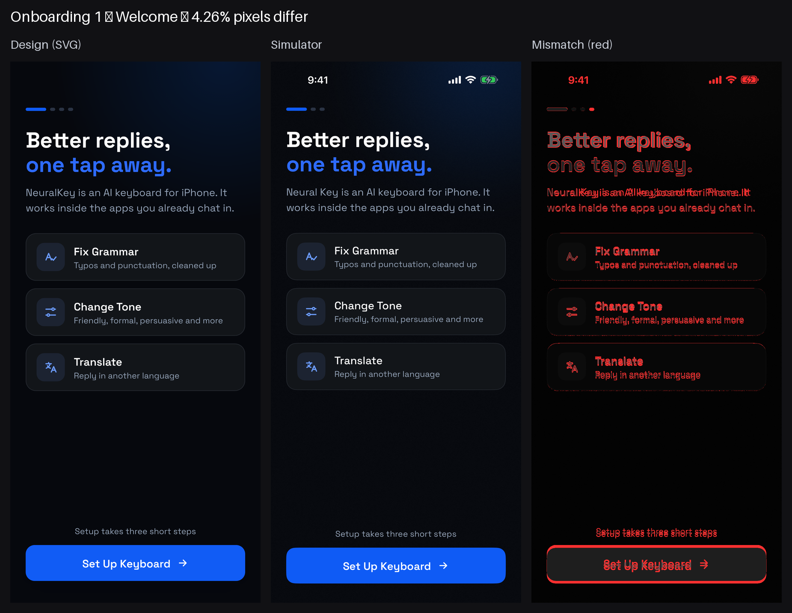

Full size: [design](design/03-onboarding-welcome.png) · [simulator](screenshots/03-onboarding-welcome.png)

## Onboarding 2 – Setup 1 of 3

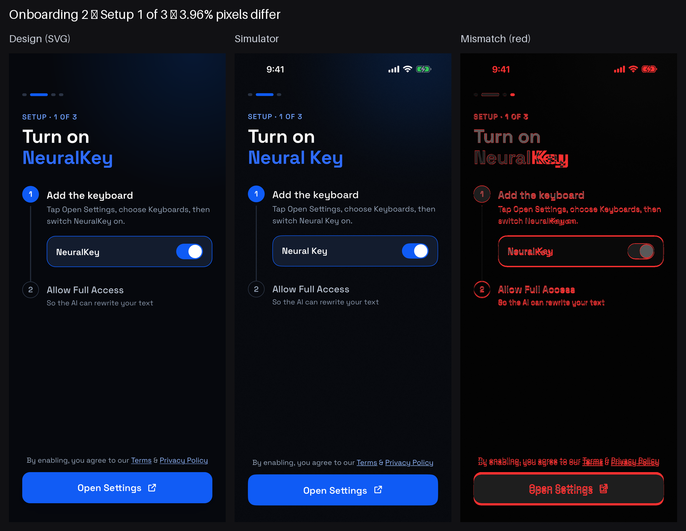

Full size: [design](design/04-onboarding-add-keyboard.png) · [simulator](screenshots/04-onboarding-add-keyboard.png)

## Onboarding 3 – Setup 2 of 3

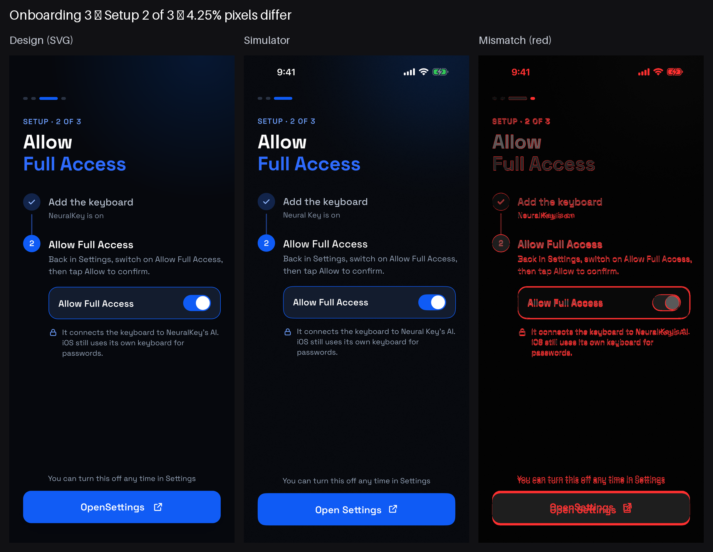

Full size: [design](design/05-onboarding-full-access.png) · [simulator](screenshots/05-onboarding-full-access.png)

## Home

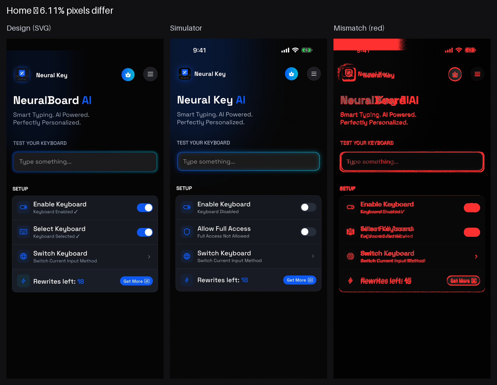

Full size: [design](design/06-home.png) · [simulator](screenshots/06-home.png)

## Premium

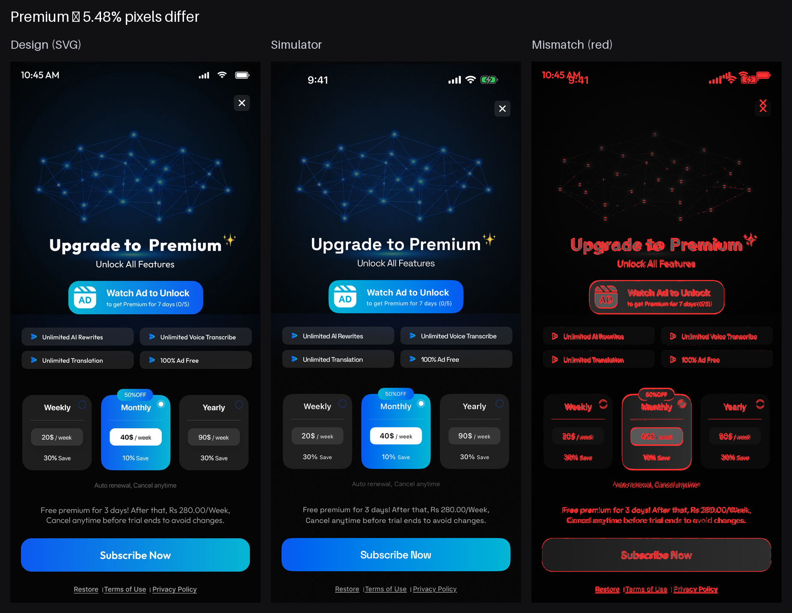

Full size: [design](design/07-premium.png) · [simulator](screenshots/07-premium.png)

## Settings

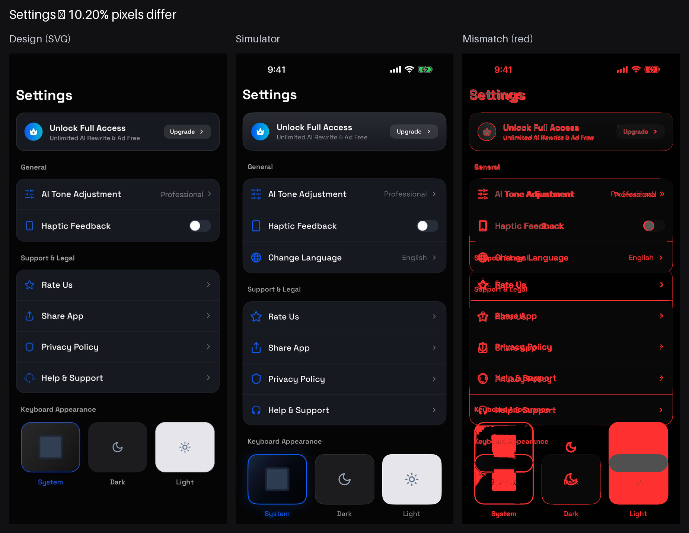

Full size: [design](design/10-settings.png) · [simulator](screenshots/10-settings.png)

## AI Tones

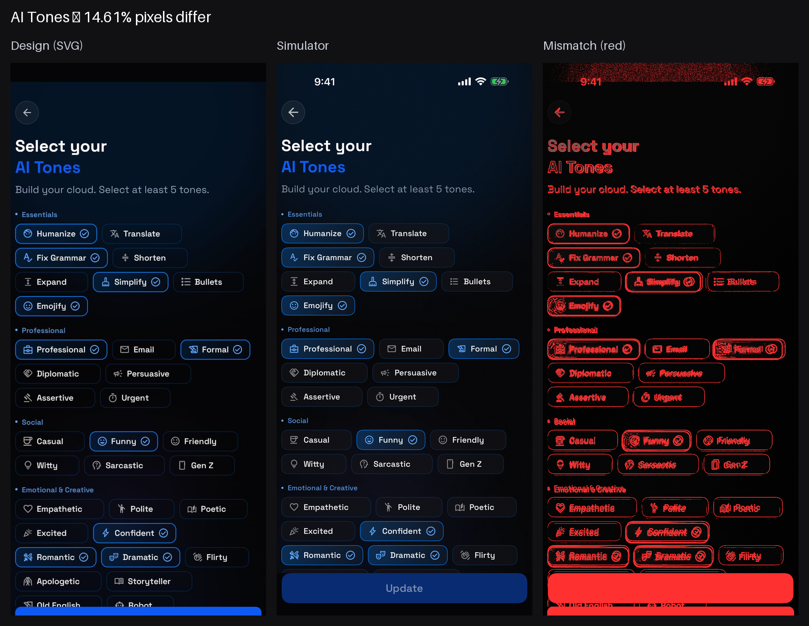

Full size: [design](design/11-ai-tones.png) · [simulator](screenshots/11-ai-tones.png)

## NeuralKey keyboard – Letters (light)

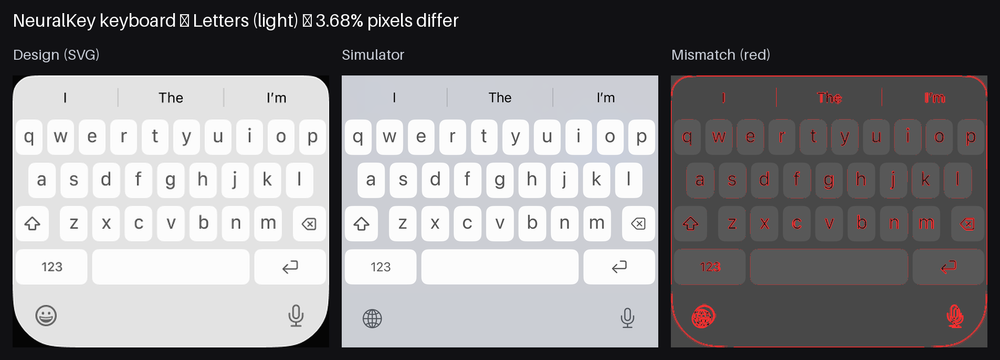

Full size: [design](design/42-extension-letters-light.png) · [simulator](screenshots/42-extension-letters-light.png)

## NeuralKey keyboard – Numbers (light)

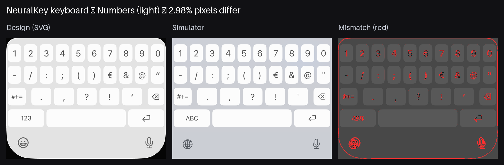

Full size: [design](design/44-extension-numbers-light.png) · [simulator](screenshots/44-extension-numbers-light.png)
