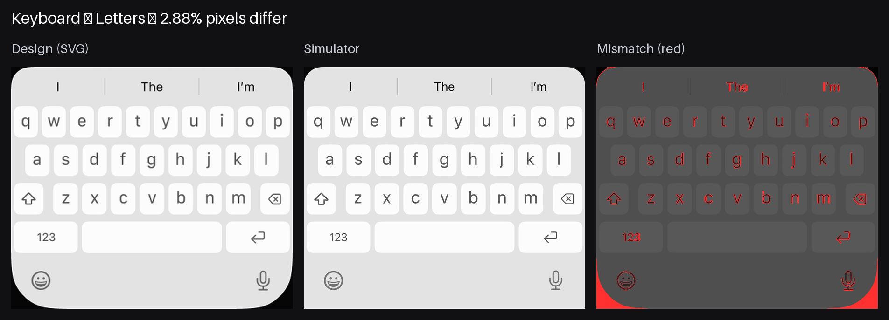
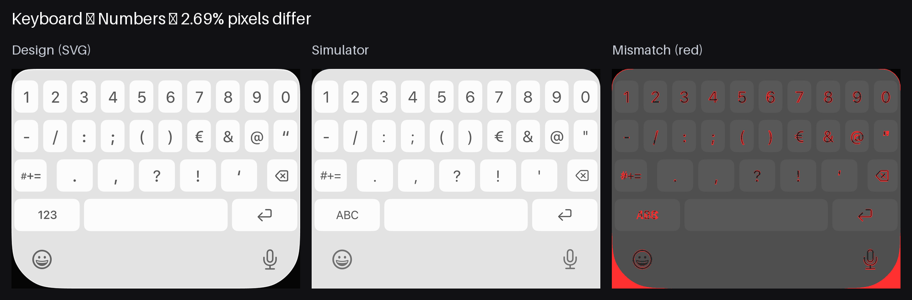
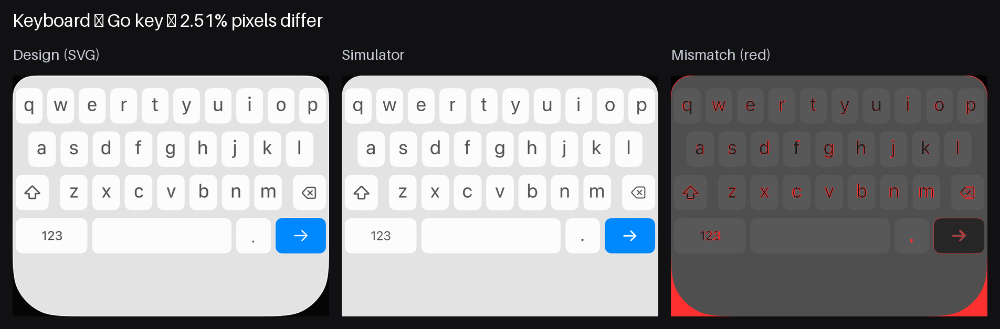
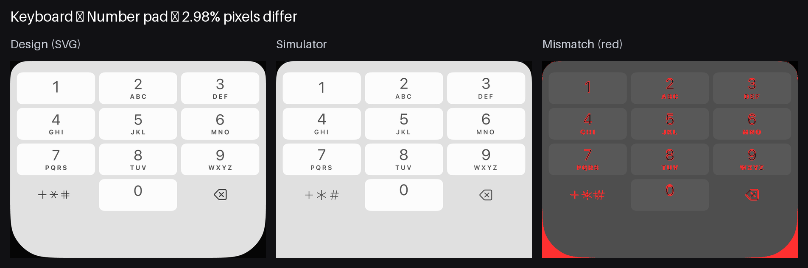

# NeuralKey — Simulator vs Design

- Commit: `86f55c7`
- Simulator: iPhone 17 Pro Max (iOS 26.2)
- Workflow run: https://github.com/farrukh-hussain-shah/Neural-IOS/actions/runs/43761098031
- Video of the run: [video/simulator-flow.mp4](video/simulator-flow.mp4)
- Mismatch = share of pixels whose colour differs by more than 32/255, excluding the status bar (47 pt) and home indicator (34 pt).
- Home, Settings and AI Tones follow the Android screenshots (Home ad removed), scaled to 390 pt and aligned to the iOS status bar.
- `Language.svg` and `Premium.svg` are 375 × 812 pt frames, so their references are scaled uniformly to 390 pt.

| Screen | Design file | Mismatch | Note |
| --- | --- | --- | --- |
| Keyboard – Letters | `Keyboard Designs/Defaulta.svg` | 2.88% | simulator 1320x1136 resized to 1206x1038 |
| Keyboard – Numbers | `Keyboard Designs/Defaultb.svg` | 2.69% | simulator 1320x1005 resized to 1206x918 |
| Keyboard – Go key | `Keyboard Designs/Default Keyboard.svg` | 2.51% | simulator 1320x1005 resized to 1206x918 |
| Keyboard – Number pad | `Keyboard Designs/Default.svg` | 2.98% | simulator 1320x1018 resized to 1206x930 |

## Keyboard – Letters

Full size: [design](design/13-keyboard-letters.png) · [simulator](screenshots/13-keyboard-letters.png)

## Keyboard – Numbers

Full size: [design](design/14-keyboard-numbers.png) · [simulator](screenshots/14-keyboard-numbers.png)

## Keyboard – Go key

Full size: [design](design/15-keyboard-go.png) · [simulator](screenshots/15-keyboard-go.png)

## Keyboard – Number pad

Full size: [design](design/16-keyboard-phone.png) · [simulator](screenshots/16-keyboard-phone.png)
